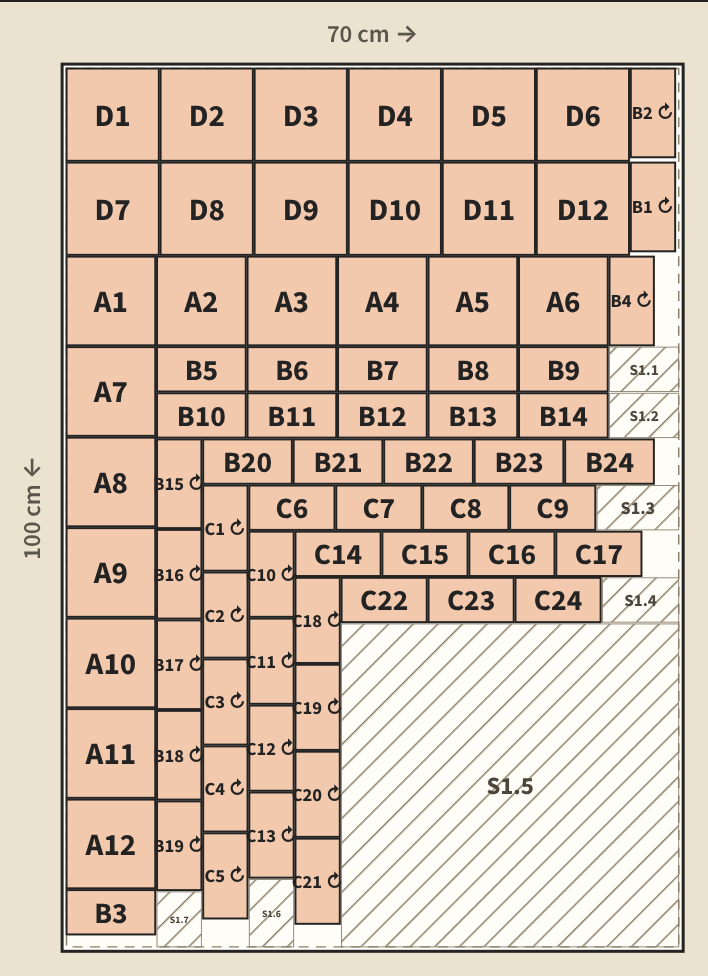
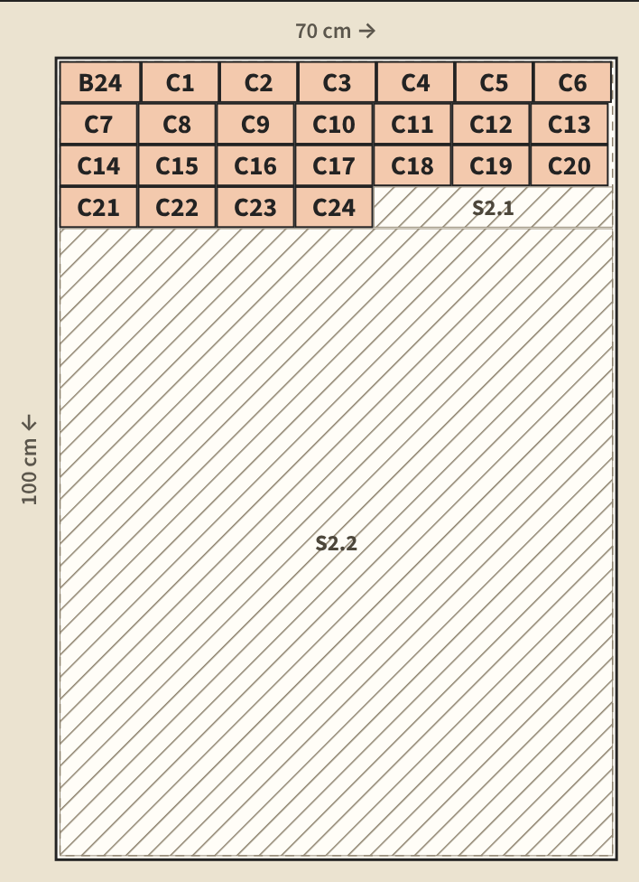

**Todos los datos y precios de esta hoja son ficticios.** Confirma con tu proveedor las medidas de la plancha y su precio.

# 1. Práctica guiada: cajitas de recuerdo para Detalles Ixchel

Detalles Ixchel es un emprendimiento ficticio de Antigua Guatemala que hace recuerdos de primera comunión. Recibe este pedido:

- **12 cajitas** de 10 × 10 × 5 cm, con tapa.
- **Material:** cartón gris de 2 mm (0,2 cm), en planchas de 70 × 100 cm. Precio de ejemplo: **Q30 por plancha**.
- **Cómo se arma:**
  - Los laterales largos miden lo mismo que la base.
  - Los laterales cortos van entre los dos largos.
  - La tapa sobresale 0,2 cm por cada lado.
- **Para cortar:** separación de corte 0,2 cm (seguridad con cúter), margen del borde 0,5 cm y sobrante útil desde 5 cm.

## Antes de abrir la app, completa la tabla

| Pieza | Ancho (cm) | Largo (cm) | Cantidad | ¿Se puede girar? |
|---|---|---|---|---|
| A · Base | 10 | 10 | 12 | Sí |
| B · Lateral largo | 10 | 5 | ____ | Sí |
| C · Lateral corto | ____ | 5 | ____ | Sí |
| D · Tapa | ____ | ____ | 12 | Sí |
| **Total de piezas** | | | ____ | |

## Paso a paso

1. Proyectos → **+ Nuevo proyecto**. Nombre: «Cajitas de recuerdo». Marca **Es de práctica**.
2. **01 Material:**
   - Material: «Cartón gris 2 mm».
   - Unidad: centímetros.
   - Ancho (→) 70 · Largo (↓) 100.
   - Planchas disponibles: 1.
   - Separación 0,2 · Margen 0,5 · Sobrante útil desde 5.
3. **02 Piezas:** carga las 4 piezas de tu tabla con **+ Agregar pieza**.
4. Revisa la barra de abajo: debe decir **72 piezas · 4849,92 cm² de piezas**.
5. Toca **Generar plano**. Anota:
   - piezas colocadas: ____
   - planchas usadas: ____
   - aprovechamiento: ____ %
6. **Reto:**
   1. Vuelve al proyecto y agrega «Bandeja exhibidora» de **40 × 60 cm**, cantidad 1.
   2. **Desmarca «Se puede girar»**: la veta debe ir a lo largo.
   3. Antes de generar el plano, calcula: ¿el área total cabe en una plancha?
7. Genera el plano con 1 plancha y anota qué pasa. Cambia «Planchas disponibles» a 2 y genera otra vez.
8. **Imprimir o guardar PDF** el plano final.
9. **Respaldo:**
   1. Copias → marca **Incluir también el ejemplo** → **Guardar una copia**.
   2. Elimina el proyecto «Cajitas de recuerdo».
   3. **Recuperar una copia** → elige el archivo → **Agregar lo nuevo**.
10. **Costo de material.** Con el Prompt 3 y luego con tu calculadora, calcula:
    - el costo de material por cajita sin la bandeja;
    - el costo de material del pedido con la bandeja.

## Comprueba tu resultado

- [ ] El proyecto lleva la etiqueta EJEMPLO.
- [ ] La barra dice 72 piezas · 4849,92 cm².
- [ ] Sin bandeja: 72 de 72 piezas, 1 de 1 plancha, 69,3 %.
- [ ] La bandeja aparece como pieza E, 40 × 60, sin giro.
- [ ] Con 1 plancha: 48 de 73 piezas, pendientes con el motivo «No alcanzó el material».
- [ ] Con 2 planchas: 73 de 73 piezas y la línea «✓ Verificado».
- [ ] El PDF del plano está guardado.
- [ ] El proyecto volvió con su plano después de recuperar la copia.
- [ ] El costo por cajita y el del pedido coinciden con tu calculadora.

# 2. Reto individual: tu próximo pedido

1. Con el **Prompt 1**, convierte tu producto en una lista de piezas. Rehaz cada cuenta de grosores.
2. Con el **Prompt 2**, revisa la lista antes de cargarla.
3. En la app, crea un proyecto **real** (sin marcar «de práctica») con las medidas reales de tu material. Genera el plano y guárdalo en PDF.
4. Con el **Prompt 3**, decide cuántas planchas comprar y calcula el costo de material por unidad con tu precio real.
5. Guarda una copia y, al terminar de practicar, ve a Copias → **Quitar el ejemplo**.

```{=openxml}
<w:p><w:r><w:br w:type="page"/></w:r></w:p>
```

# Respuestas (para el facilitador)

## Tabla de piezas

| Pieza | Ancho (cm) | Largo (cm) | Cantidad | Cuenta |
|---|---|---|---|---|
| A · Base | 10 | 10 | 12 | 1 por cajita |
| B · Lateral largo | 10 | 5 | 24 | 2 por cajita × 12 |
| C · Lateral corto | 9,6 | 5 | 24 | 10 − 2 × 0,2 = 9,6; 2 por cajita × 12 |
| D · Tapa | 10,4 | 10,4 | 12 | 10 + 2 × 0,2 = 10,4 |
| **Total** | | | **72** | 12 + 24 + 24 + 12 |

**Área de las piezas:**
12 × 100 + 24 × 50 + 24 × 48 + 12 × 108,16 = 1200 + 1200 + 1152 + 1297,92 = **4849,92 cm²**.

## Resultados del plano

| Caso | Piezas | Planchas | Aprovechamiento | Pendientes |
|---|---|---|---|---|
| Sin bandeja, 1 plancha | 72 de 72 | 1 de 1 | 69,3 % | ninguna |
| Con bandeja, 1 plancha | 48 de 73 | 1 de 1 | 86,4 % | 25: B24 y C1 a C24, «No alcanzó el material» |
| Con bandeja, 2 planchas | 73 de 73 | 2 de 2 | 51,8 % | ninguna |

## Explicación

- **Área útil.** (70 − 2 × 0,5) × (100 − 2 × 0,5) = 69 × 99 = 6831 cm² por plancha.
- **Con bandeja no cabe en una plancha.** El área total es 4849,92 + 40 × 60 = 7249,92 cm², mayor que 6831 cm², así que hacen falta dos planchas aunque las piezas se acomodaran perfecto. Lo contrario no se cumple: que el área alcance no garantiza que todo quepa.
- **Por qué quedan fuera los laterales.** La app coloca primero las piezas grandes. La bandeja ocupa su lugar y, con una plancha, quedan pendientes un lateral largo y los 24 cortos.
- **Aprovechamiento** = área de piezas ÷ área total de las planchas usadas, con el margen incluido:
  - 4849,92 ÷ 7000 = 69,3 %;
  - 6047,92 ÷ 7000 = 86,4 % (las 48 piezas colocadas con una plancha);
  - 7249,92 ÷ 14 000 = 51,8 %.
- **Sobrantes.**
  - Sin bandeja queda un sobrante útil grande, S1.5, de 38 × 36,4 cm.
  - Con 2 planchas queda S2.2 de 69 × 78,2 cm = 5395,8 cm². Es cerca del 77 % de una plancha y se puede usar en otro pedido. La app no lo guarda como inventario: hay que anotarlo.
- **Costo de material** (precio de ejemplo):
  - Sin bandeja: Q30 ÷ 12 = **Q2,50 por cajita**.
  - Con bandeja: 2 × Q30 = **Q60 el pedido**.
  - Solo es el cartón: faltan mano de obra, pegamento, papel decorativo y otros insumos.
- **«Propuesta comprobada», no «óptima».** La app prueba 15 combinaciones y verifica el plano, pero no garantiza que sea el de menor desperdicio posible.
- **Respaldo.** El proyecto de práctica lleva la etiqueta EJEMPLO. Por eso hay que marcar «Incluir también el ejemplo». El aviso esperado es «Copia recuperada: se agregaron 1 proyecto».

**Cómo se comprobaron estas respuestas.** Se calcularon con el motor real de la app (`cortes/src/engine.js`) y se revisaron con su verificador independiente. Además se repitieron en la interfaz con el script `talleres/scripts/capturas-cortes.mjs`, que confirma 72 de 72 con 69,3 %, 48 de 73 con 1 plancha y 73 de 73 con 2 planchas.

{width=6cm} {width=6cm}
