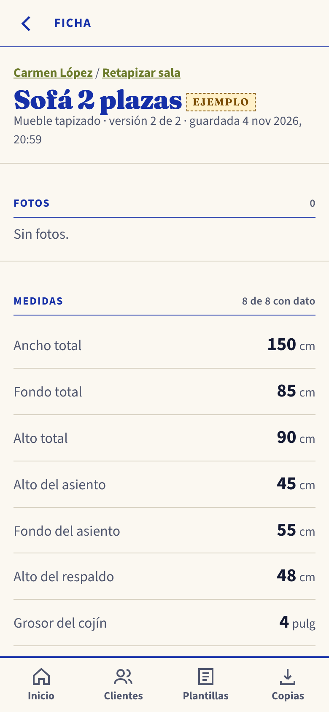
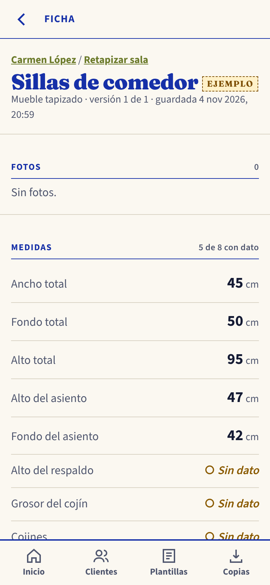
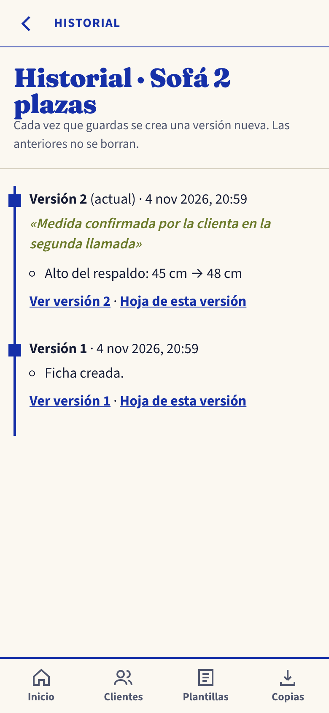

**Todos los datos de esta hoja son ficticios.** No uses datos de clientes reales en la práctica ni en la IA.

# 1. Práctica guiada: Tapicería El Buen Asiento

El Buen Asiento es un taller de tapicería ficticio en Villa Nueva. Su clienta, Carmen López (ficticia), quiere retapizar la sala. Estos son los apuntes de la visita:

```
Sra. Carmen L. — retapizar sala
sofá 2 plazas: ancho 1.50 m, fondo 85, alto 90
  asiento: alto 45, fondo 55 · respaldo: 45 de alto
  cojín de 4 pulg · 3 cojines
  tela microfibra gris oxford, con vivo
  pata trasera izq. floja: revisar
sillas de comedor (4 iguales): ancho 45, fondo 50, alto 95
  asiento a 47 del piso, fondo 42 · cojín ¿2 pulg?
espuma: preguntar densidad
```

**Después de la segunda llamada:** «El respaldo del sofá mide 48 cm, no 45».

## Antes de abrir la app, responde

1. ¿Qué medidas están en una unidad distinta de cm?
2. ¿Qué datos de las sillas no aparecen en los apuntes?
3. ¿Qué dato es dudoso y cómo lo vas a registrar?

## Paso a paso

1. Inicio → **+ Nuevo proyecto**.
   - Cliente nuevo: «Carmen López».
   - Proyecto: «Retapizar sala».
   - Lugar: «Villa Nueva».
   - Marca **Es de práctica**.
2. **+ Nueva ficha** → «Sofá 2 plazas» → plantilla **Mueble tapizado** → Crear y completar.
3. **Medidas del sofá en cm.** El grosor del cojín va en **pulg**: cambia la unidad en el selector de esa medida.
4. **Especificaciones del sofá:** escribe o toca solo lo que dicen los apuntes. Deja vacío lo que no se dijo.
5. Toca **Guardar versión 1**.
6. Vuelve al proyecto → **+ Nueva ficha** → «Sillas de comedor» → plantilla Mueble tapizado.
   - Carga solo lo que dicen los apuntes.
   - Lo dudoso no se carga como dato: anótalo en **Observaciones**.
   - Guarda con «Guardar con datos faltantes».
7. **Corrige el sofá:** Editar ficha → Alto del respaldo: 48 → en «¿Qué cambió y por qué?» escribe el motivo → **Guardar versión 2**.
8. Abre el **Historial** del sofá y la **Hoja de trabajo del proyecto**.
9. **Respaldo:**
   1. Copias → marca **Incluir también los datos de ejemplo** → **Guardar una copia**.
   2. Elimina la ficha «Sillas de comedor».
   3. Copias → **Recuperar una copia** → elige el archivo → **Agregar lo nuevo**.

## Comprueba tu resultado

- [ ] El proyecto lleva la etiqueta EJEMPLO y tiene 2 fichas.
- [ ] El sofá está en la versión 2 de 2, con 8 de 8 medidas con dato y el respaldo en 48 cm.
- [ ] El Historial dice «Alto del respaldo: 45 cm → 48 cm».
- [ ] El ancho total del sofá dice 150 cm, no 1.5 cm.
- [ ] El grosor del cojín del sofá dice 4 pulg.
- [ ] «Espuma» dice «Sin dato» en las dos fichas.
- [ ] Las sillas tienen 5 de 8 medidas con dato.
- [ ] La hoja de trabajo del proyecto muestra «SIN DATO — completar».
- [ ] La ficha de las sillas volvió después de recuperar la copia.
- [ ] Al buscar «carmen» en Inicio aparece el proyecto.

# 2. Reto individual: la plantilla de tu oficio

1. Con el **Prompt 2**, pide a la IA los campos de tu oficio. Revisa la propuesta: quita lo que nunca mides y agrega lo que falta.
2. En la app: Plantillas → elige la más parecida → **Duplicar plantilla**.
   - Cambia nombres, unidades, ayudas y opciones.
   - Agrega o quita campos.
3. Crea un proyecto **real** (sin marcar «de práctica») con una ficha de un trabajo tuyo y una foto. Usa iniciales del cliente.
4. Guarda una copia en Drive o en tu correo.

**Tarea para mañana:** registra el próximo trabajo que midas con tu plantilla. Al terminar de practicar, ve a Copias → **Quitar los datos de ejemplo**.

```{=openxml}
<w:p><w:r><w:br w:type="page"/></w:r></w:p>
```

# Respuestas (para el facilitador)

## Antes de abrir la app

1. «1.50 m» está en metros: equivale a 150 cm. «4 pulg» está en pulgadas: se registra en pulg, porque así se midió.
2. De las sillas no aparecen: tela, color, espuma, costura, estructura, alto del respaldo, grosor del cojín (es dudoso) y cantidad de cojines.
3. El cojín de las sillas, «¿2 pulg?». Se deja **vacío** y se anota en Observaciones: «Son 4 sillas iguales. Grosor del cojín dudoso (¿2 pulg?): medir otra vez».

## Resultado esperado

| Medida | Sofá 2 plazas (versión 2) | Sillas de comedor (versión 1) |
|---|---|---|
| Ancho total | 150 cm | 45 cm |
| Fondo total | 85 cm | 50 cm |
| Alto total | 90 cm | 95 cm |
| Alto del asiento | 45 cm | 47 cm |
| Fondo del asiento | 55 cm | 42 cm |
| Alto del respaldo | 48 cm (era 45 en la versión 1) | Sin dato |
| Grosor del cojín | 4 pulg | Sin dato (dudoso, en Observaciones) |
| Cojines | 3 unid. | Sin dato |

| Especificación | Sofá | Sillas |
|---|---|---|
| Mueble | Sofá | Silla de comedor |
| Tela | Microfibra | Sin dato |
| Color | Gris oxford | Sin dato |
| Espuma | Sin dato | Sin dato |
| Costura o acabado | Vivo | Sin dato |
| Estructura y patas | Revisar pata trasera izquierda (floja) | Sin dato |

## Explicación

- **Unidades.** 1,50 m × 100 = 150 cm. Si alguien escribe «1.50» en un campo de cm, la app lo acepta como 1.5 cm porque es un número válido. Por eso hay que mirar que el valor tenga sentido.
- **Vacío no es cero.** Lo que no se midió queda vacío y la app escribe «Sin dato». Un 0 diría que esa medida es cero de verdad.
- **No suponer.** Que el sofá sea de microfibra no dice nada de las sillas. Suponerlo puede costar tela equivocada.
- **Cojines de las sillas.** Si se confirma que cada silla lleva un cojín, se puede registrar 4 en una versión nueva. Mientras no se confirme, queda vacío.
- **Versiones.** La corrección crea la versión 2 y la versión 1 conserva el 45. El Historial muestra el cambio y su motivo.
- **Respaldo.** El proyecto de práctica lleva la etiqueta EJEMPLO. Por eso la copia solo lo incluye si se marca «Incluir también los datos de ejemplo». «Agregar lo nuevo» trae la ficha borrada y no modifica nada de lo que ya estaba. El aviso esperado es «Copia recuperada: se agregaron 1 ficha y 0 fotos».

**Cómo se comprobaron estas respuestas.** Se resolvió el ejercicio en la app real con el script `talleres/scripts/comprobar-ejercicio-fichero.mjs`. El script confirma: sofá con 8 de 8 medidas con dato, sillas con 5 de 8, «Alto del respaldo: 45 cm → 48 cm» en el Historial, «SIN DATO — completar» en la hoja y la búsqueda por «carmen».

{width=5cm} {width=5cm} {width=5cm}
